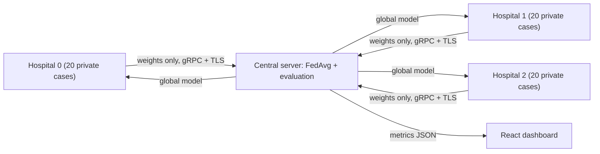

## Mid-Project Audit

| Check | Result |
|---|---|
| Centralized baseline (15 epochs, 60 cases) | best mean Dice 0.3291 |
| Federated FedAvg (15 rounds, 3 hospitals, TLS) | best mean Dice 0.2366 (72% of baseline) |
| Transport security | gRPC + TLS; plain client rejected (`UNAVAILABLE`) |
| Node resilience | crashed hospital: 2 results, 1 failure; training continued |
| Data exposure | payload audit: only weight arrays sent, no image-shaped tensors |

Setup: CPU-only, 64^3 patches, small 3D U-Net (8-128 channels), 60 MSD Task01 cases
split 20/20/20 across hospitals, shared 12-case validation set. Absolute Dice is low
because of the reduced scale; the federated-vs-centralized comparison is the point.
## Architecture

Roadmap: Week 3 adds TenSEAL homomorphic encryption and live WebSocket metrics. Week 4 adds differential privacy.
