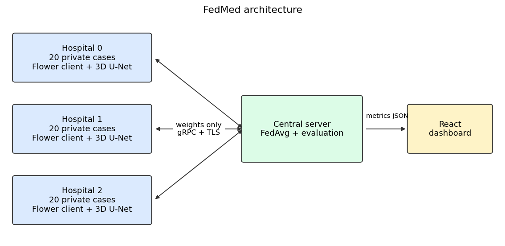

## Mid-Project Audit

| Check | Result |
|---|---|
| Centralized baseline (15 epochs, 60 cases) | best mean Dice 0.3291 |
| Federated FedAvg (15 rounds, 3 hospitals, TLS) | best mean Dice 0.2366 (72% of baseline) |
| Transport security | gRPC + TLS; plain client rejected (`UNAVAILABLE`) |
| Node resilience | crashed hospital: 2 results, 1 failure; training continued |
| Data exposure | payload audit: only weight arrays sent, no image-shaped tensors |

Setup: CPU-only, 64^3 patches, small 3D U-Net (8-128 channels), 60 MSD Task01 cases
split 20/20/20 across hospitals, shared 12-case validation set. Absolute Dice is low
because of the reduced scale; the federated-vs-centralized comparison is the point.
## Architecture

Roadmap: Week 3 adds TenSEAL homomorphic encryption and live WebSocket metrics. Week 4 adds differential privacy.

## Homomorphic Encryption Results (Week 3)

| Check | Result |
|---|---|
| Scheme | CKKS (TenSEAL), poly degree 8192, 4096 values per ciphertext |
| Server key | public context only; `Server holds secret key: False` |
| Aggregation | server adds ciphertexts without decrypting (295 per hospital per round) |
| Accuracy | rounds 1-5: encrypted Dice tracks plain (0.1501 vs 0.1498 at round 5) |
| Upload cost | 98.6 MB vs 4.8 MB plaintext per hospital per round (about 20x) |
| Memory | server was killed at round 6 on a 15 GB laptop; comparison covers 5 rounds |

**Caveats**
- All hospitals share one secret key. A leaked hospital copy breaks confidentiality; real deployments need threshold or multi-party key schemes.
- The round-1 starting model is a plaintext random initialisation with no patient data.
- Evaluation runs at the hospitals (they decrypt), not on the server.
- Encrypted and plain runs differ in random seeds, so small Dice gaps are noise.

## Differential Privacy (Week 4)

Each hospital clips its update to L2 norm 1.0 and adds Gaussian noise (std = noise x clip) before sending.
5 rounds, 30 cases, fixed seed, one run per setting.

| Noise | Final mean Dice | Approx. epsilon per round | After 5 rounds |
|---|---|---|---|
| 0.0 | 0.0798 | no noise | - |
| 0.005 | 0.0771 | 969.0 | 4844.8 |
| 0.02 | 0.0762 | 242.2 | 1211.2 |
| 0.05 | 0.0550 | 96.9 | 484.5 |
| 0.2 | 0.0505 | 24.2 | 121.1 |
| 1.0 | 0.0527 | 4.8 | 24.2 |
| 4.0 | 0.0234 | 1.2 | 6.1 |

**Caveats**
- Epsilon uses the classic Gaussian bound with simple composition and delta = 1e-5. It is a loose upper bound, and the classic bound is only valid for epsilon per round of 1 or less.
- One run per setting on a barely trained model, so small Dice gaps are within run-to-run noise.
- Clipping alone costs accuracy: updates have norm about 4.4 and are clipped to 1.0.
- Encryption and DP were evaluated separately, not combined.
